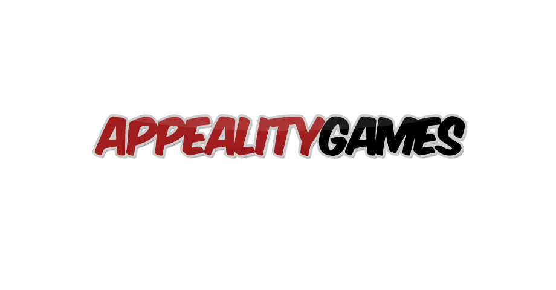

# 🧩 Physics-Puzzle

<p align="center">
  
</p>

**Physics-Puzzle** is a fun, web-based physics puzzle game built with Construct 2. Use crates, TNT, planks and more to guide the bone to the dog across **10 handcrafted levels** — straight in your browser, no install needed.

[](https://html.spec.whatwg.org)
[](https://www.construct.net)
[](#-how-to-play)
[](#-license)

---

## 🎮 How to Play

1. **Tap/click a crate** — drag it into place to build a path
2. **Drop and explode TNT** to clear obstacles
3. **Guide the bone** so it reaches the dog 🦴🐶
4. **10 levels** of increasing difficulty — test your physics skills!

## ✨ Features

- 🎲 Real physics — gravity, stacks, chain reactions
- 💥 TNT explosions, dust effects, chew-toys & more
- 🎵 Original soundtrack & sound effects
- 📈 Level select with per-level progression (saved locally)
- 🌐 Runs in any modern browser — desktop & mobile

## 🚀 Play It

1. Clone the repository
   ```bash
   git clone https://github.com/awaisdev5765/Physics-Puzzle.git
   ```
2. Serve the `production/` folder over HTTP (the game won't run from a double-clicked file):
   ```bash
   cd Physics-Puzzle/production
   python3 -m http.server 8080
   ```
3. Open **http://localhost:8080** in your browser and play!

## 🛠 Tech Stack

| | |
|---|---|
| **Engine** | Construct 2 (r239+) |
| **Runtime** | HTML5 + jQuery |
| **Physics** | Built-in Construct 2 physics engine |
| **Audio** | OGG / M4A / WAV, loaded from `production/media/` |
| **Source** | `.caproj` project included under `source/` for editing |

## 📂 Project Structure

```
├── production/          # Playable HTML5 export (deploy this)
│   ├── index.html       # Entry point
│   ├── c2runtime.js     # Construct 2 runtime
│   ├── images/          # Sprites & backgrounds
│   ├── media/           # Music & SFX
│   └── offline.appcache # Offline caching manifest
└── source/              # Construct 2 editor project
    ├── Physics Puzzle 1.caproj
    ├── Layouts/         # Title, levelSelect, Level1-10, Instructions
    ├── Event sheets/    # Game logic
    ├── Textures/        # Sprites
    └── Files/           # Audio sources
```

## ☕ Support

If you enjoy the game, please consider supporting my work:

<p align="center">
  <a href="https://buymeacoffee.com/awaisdev572">
    
  </a>
</p>

Or [become a supporter on Buy Me a Coffee](https://buymeacoffee.com/awaisdev572) 💛

## 📄 License

- **Playable web build** (`production/`) — free to play and share
- **Source project** (`source/`) — Construct 2 is a commercial editor; you'll need a [Construct 2/3 license](https://www.construct.net/en/make-your-own-games) to edit and re-export the `.caproj` project
- Game assets & design © original author, redistributed here for free play — see `help.pdf` for the original game manual

## 📬 Contact

Questions or suggestions? Open an [issue](https://github.com/awaisdev5765/Physics-Puzzle/issues) or support me on [Buy Me a Coffee](https://buymeacoffee.com/awaisdev572).
